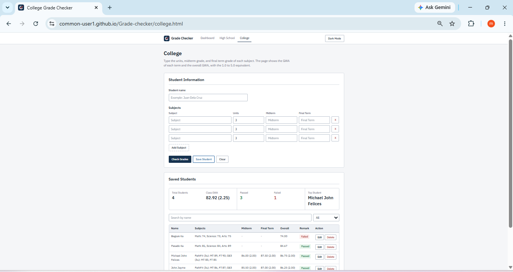

# Grade Checker

This is a web page that checks the grades of students. The user types the student name, then the subjects with their grades and units. The page shows the GWA, remark, letter grade, and highest grade. The user can also save many students in a list.

## Live Demo

https://common-user1.github.io/Grade-checker/

## How to run

1. Download or clone this repository.
2. Open the `index.html` file in a browser.
3. Type the student name.
4. Type the subject names, grades, and units. Click **Add Subject** to add more, or **X** to remove one.
5. Click **Check Grades** to see the result.
6. Click **Save Student** to add the student to the Saved Students table.
7. Click **Clear** to start again.

## Features

- Add or remove subjects, with units for each subject
- Computes the GWA (weighted average) using the units
- Shows the remark, letter grade, and highest grade
- Saves a list of students, and the list stays after refreshing the page
- Search students by name, and filter Passed or Failed
- Summary cards: total students, class GWA, passed, failed, and top student
- Click the table headings to sort the list
- Edit or delete a saved student
- Dark mode, and the page remembers your choice
- Works on computers and phones

## Files

- `index.html` - the page
- `style.css` - the colors and layout
- `grade.js` - the functions that compute the grades
- `app.js` - connects the page to the functions, and saves the students